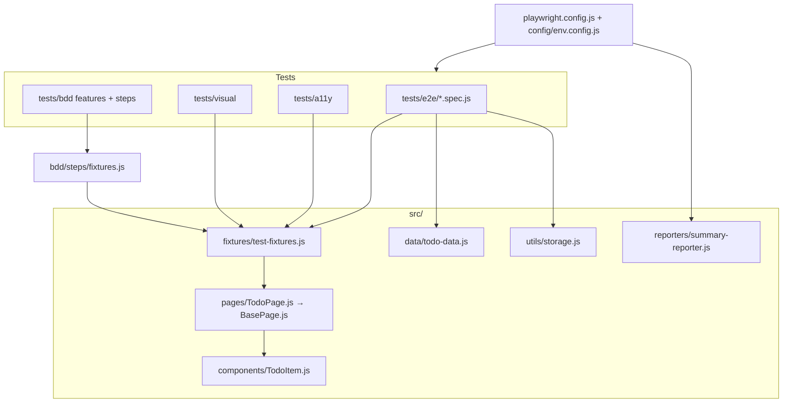
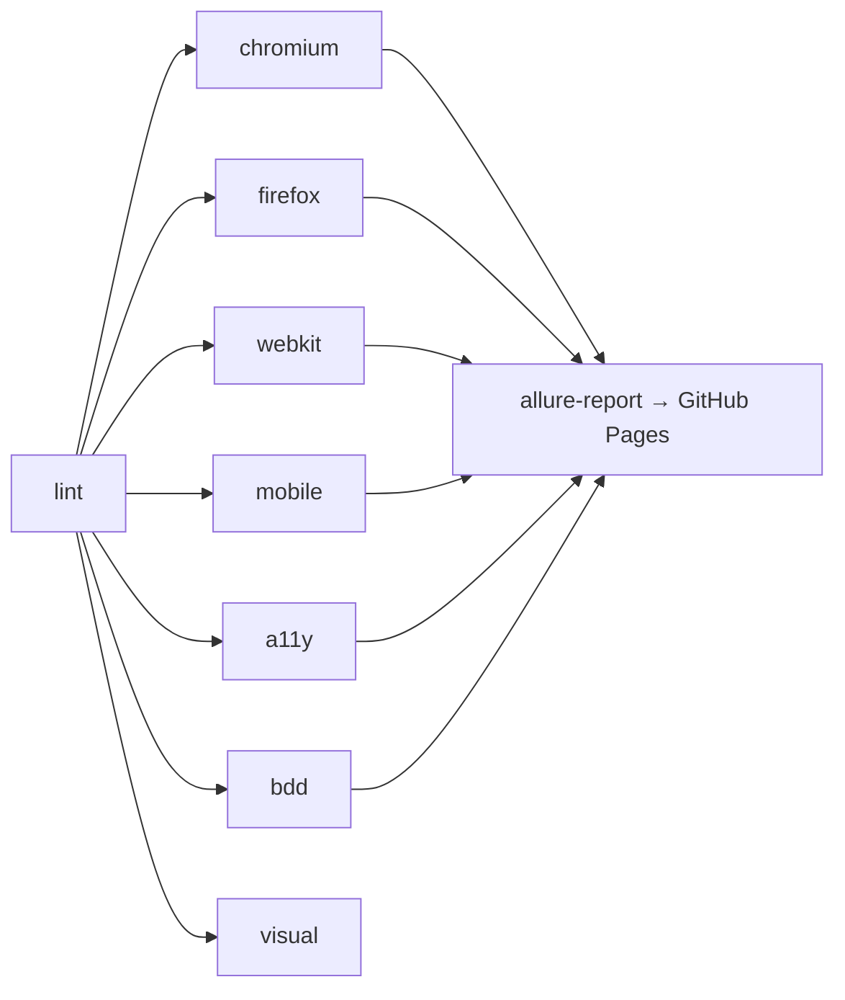

# Framework Guide

This guide explains **what** the framework contains, **why** each choice was made, and **how** it was built step by step. Use it as your study notes. The interview Q&A is in [03-INTERVIEW-GUIDE.md](03-INTERVIEW-GUIDE.md).

---

## 1. The application under test

`https://demo.playwright.dev/todomvc/` is a React implementation of TodoMVC.

| Feature         | Behaviour (verified by probing the DOM before writing tests)                    |
| --------------- | ------------------------------------------------------------------------------- |
| Add             | Type in `What needs to be done?` + Enter. Input is trimmed, blank input ignored |
| Complete        | Checkbox per row (`aria-label="Toggle Todo"`), row gets the `completed` class   |
| Toggle all      | `Mark all as complete` checkbox                                                 |
| Edit            | Double-click label. Enter or blur saves, Escape cancels, empty deletes          |
| Delete          | `×` button, **visible only on hover**                                           |
| Counter         | `N item(s) left`, singular/plural, counts active only                           |
| Filters         | All / Active / Completed, hash routing `#/`, `#/active`, `#/completed`          |
| Clear completed | Button visible only when at least one item is completed                         |
| Persistence     | `localStorage["react-todos"]` = `[{ id, title, completed }]`                    |
| Empty state     | `section.main` and `footer.footer` hidden when the list is empty                |
| Test hooks      | `data-testid="todo-item"`, `todo-title`, `todo-count`                           |

> **Habit to mention in interviews:** I first explored the app manually and with a throwaway Playwright script that dumped the DOM and localStorage. This showed the test IDs, ARIA labels and storage key _before_ I designed the locators.

---

## 2. Architecture



**Layers**

1. **Config layer** (`playwright.config.js`, `config/env.config.js`): where and how to run (URLs, browsers, retries, reporters).
2. **Framework layer** (`src/`): reusable code with no test logic, made of page objects, components, fixtures, data and utils.
3. **Test layer** (`tests/`): only scenarios and assertions. Tests read like specifications.

This separation means that when a locator changes, you fix **one** line in the page object and none of the tests.

---

## 3. Tools used – what and why

| Tool                                                       | What it is                                                     | Why I chose it                                                                                                                                                         | Alternatives considered                                                                        |
| ---------------------------------------------------------- | -------------------------------------------------------------- | ---------------------------------------------------------------------------------------------------------------------------------------------------------------------- | ---------------------------------------------------------------------------------------------- |
| **Playwright Test** (`@playwright/test`)                   | Test runner + browser automation for Chromium, Firefox, WebKit | Auto-waiting, web-first assertions, built-in parallelism, tracing, fixtures, multi-browser from one API, fast (CDP/WebSocket, no WebDriver)                            | Selenium (slower, manual waits, needs grid), Cypress (single tab, limited WebKit/multi-domain) |
| **JavaScript (ESM)**                                       | `"type": "module"`                                             | Modern `import/export`, same language as the app, Faker v10 is ESM-only                                                                                                | TypeScript (adds type safety; easy migration later)                                            |
| **Page Object Model + Component Objects**                  | `TodoPage`, `TodoItem`                                         | Single source of truth for locators, readable tests, less duplication                                                                                                  | Screenplay pattern (heavier), raw locators in tests (brittle)                                  |
| **Custom fixtures**                                        | `test.extend({...})`                                           | Dependency injection, so setup/teardown is reusable and lazy. Replaces `beforeEach` boilerplate                                                                        | Hooks in each file                                                                             |
| **playwright-bdd**                                         | Converts `.feature` files into Playwright tests                | Gherkin for business readability, **while keeping** Playwright's runner, fixtures, parallelism, trace and reports                                                      | `@cucumber/cucumber` (separate runner, loses Playwright fixtures and parallel features)        |
| **@axe-core/playwright**                                   | Deque's axe accessibility engine                               | Industry standard for automated WCAG checks                                                                                                                            | Lighthouse, pa11y                                                                              |
| **Playwright `toHaveScreenshot`**                          | Built-in visual comparison                                     | No 3rd-party SaaS needed, pixel diff with thresholds                                                                                                                   | Percy, Applitools (AI diff, paid)                                                              |
| **@faker-js/faker**                                        | Random realistic data                                          | Unique data avoids test interdependence and finds unexpected bugs                                                                                                      | Static fixtures only                                                                           |
| **dotenv + cross-env**                                     | Env variables from `.env` and cross-platform env setting       | Switch environments without code changes (12-factor config)                                                                                                            | Hard-coded URLs                                                                                |
| **allure-playwright + allure (v3 CLI)**                    | Rich reporting                                                 | Dashboards, history/trends, categories, attachments. Allure 3 is pure Node, **so no Java** is needed                                                                   | ReportPortal, extent                                                                           |
| **Custom summary reporter**                                | `src/reporters/summary-reporter.js`                            | One self-contained HTML file with totals, pass rate, per-browser breakdown, and **why** each test failed with an embedded screenshot. Easy to email or attach to Slack |                                                                                                |
| **HTML / JUnit / JSON reporters**                          | Built-in                                                       | HTML for debugging, JUnit for CI test tabs, JSON for custom tooling                                                                                                    |                                                                                                |
| **ESLint (flat config) + eslint-plugin-playwright**        | Static analysis                                                | Catches `waitForTimeout`, focused tests (`test.only`), missing `await`, non-web-first assertions                                                                       |                                                                                                |
| **Prettier**                                               | Formatter                                                      | Removes style debates in code review                                                                                                                                   |                                                                                                |
| **Husky + lint-staged**                                    | Git hooks                                                      | Lints/formats **only staged files** on commit, so bad code never reaches CI                                                                                            |                                                                                                |
| **Docker** (official `mcr.microsoft.com/playwright` image) | Container with browsers + OS deps                              | "Works on my machine" solved. Identical fonts/rendering for visual tests. Same image locally and in CI                                                                 | Installing browsers on agents                                                                  |
| **docker compose**                                         | Multi-container runner                                         | One command with volumes for reports, `ipc: host` for Chromium                                                                                                         |                                                                                                |
| **GitHub Actions**                                         | CI/CD                                                          | Free for public repos. Matrix per browser, artifacts, Pages for Allure                                                                                                 |                                                                                                |
| **Jenkins** (`Jenkinsfile`)                                | CI/CD (common in enterprises)                                  | Declarative pipeline, parameters, cron, JUnit/HTML/Allure publishing                                                                                                   | GitLab CI, Azure DevOps                                                                        |

---

## 4. Key design decisions (and the reasoning)

### 4.1 Locator strategy

Priority order (it mirrors Playwright's own recommendation):

1. **Role + accessible name**: `getByRole('button', { name: 'Clear completed' })`. This is how users and assistive tech find things, and it doubles as an a11y check.
2. **Label / placeholder**: `getByLabel('Mark all as complete')`, `getByPlaceholder('What needs to be done?')`.
3. **Test IDs**: `getByTestId('todo-item')`, used where the developers added stable hooks.
4. **CSS**: only for structural containers without semantics (`section.main`, `footer.footer`).
5. **Never** XPath based on DOM position.

Locating a row by title uses `filter({ has })` with `and()`:

```js
this.todoItems.filter({
  has: page.getByTestId('todo-title').and(page.getByText(title, { exact: true })),
});
```

### 4.2 Page Object + Component Object

- `TodoPage` holds page-level locators and actions (`addTodo`, `filterBy`, `toggleAll`, `clearCompleted`).
- `todoPage.todo('Buy milk')` or `todoPage.todo(0)` returns a **`TodoItem` component** with `complete()`, `edit()`, `delete()` and so on. Repeating UI fragments become small objects instead of one huge page class.
- **Page objects contain no assertions.** Tests own the assertions. The POM stays reusable for both positive and negative checks, and failures point at the test line.

### 4.3 Fixtures instead of hooks

```js
test('deletes a todo', async ({ seededTodoPage }) => { ... });
```

- `todoPage`: opens the app, returns a page object.
- `seededTodoPage`: builds on `todoPage` and adds 3 known items (**fixtures compose**).
- `browserErrors` (**auto fixture**): listens for `pageerror` / console errors and attaches them to the report for every test.
- Fixtures are **lazy**: a test that doesn't ask for `seededTodoPage` doesn't pay for it.
- The fixture object is exported so the BDD layer reuses it (`playwright-bdd` requires its own `test` base, see `tests/bdd/steps/fixtures.js`).

### 4.4 Test isolation

Every test gets a **fresh browser context** (new cookies and localStorage), so tests never depend on each other and can run fully parallel (`fullyParallel: true`). `persistence.spec.js` explicitly proves this isolation.

### 4.5 Setup through the "back door"

`utils/storage.js#seedTodos()` writes straight to `localStorage` and reloads. That is far faster than clicking through the UI. In a real app the equivalent is seeding through an **API** or **DB** call, and the UI is only used for the behaviour under test.

### 4.6 Test data

- `TODO_ITEMS`: static, used where exact values matter (ordering, visual baselines).
- `EDGE_CASE_TITLES`: special chars, unicode, emoji, RTL/CJK, HTML/XSS, SQL-like, 500-char strings.
- `generateTodoTitles(n)`: Faker-generated, so data differs on each run.

### 4.7 Tags and suites

Playwright's native tags: `test('…', { tag: '@smoke' }, …)` and `test.describe('…', { tag: '@regression' }, …)`.

- `@smoke`: core happy paths. Run on every PR and on mobile.
- `@regression`: everything functional. Run nightly.
- `@a11y`, `@visual`, `@security`: run separately.

Run with `--grep @smoke` or `--grep-invert @visual`.

### 4.8 Projects (`playwright.config.js`)

| Project                       | What                            | Notes                                                 |
| ----------------------------- | ------------------------------- | ----------------------------------------------------- |
| chromium / firefox / webkit   | All `tests/e2e`                 | Cross-browser                                         |
| mobile-chrome / mobile-safari | `@smoke` only (`grep`)          | Pixel 7 / iPhone 15 emulation (viewport, UA, touch)   |
| a11y                          | `tests/a11y`                    | Chromium only, since axe results don't vary by engine |
| visual                        | `tests/visual`                  | Fixed 1280×720 viewport                               |
| bdd                           | Generated from `.feature` files | `defineBddConfig()` outputs to `.features-gen/`       |

### 4.9 Flakiness controls

- **No hard waits.** ESLint forbids `waitForTimeout`. Playwright auto-waits for actionability, and `expect(...)` auto-retries (web-first assertions).
- `expect.poll()` for non-DOM state (localStorage).
- `retries: 2` **only on CI**. Locally a failure should fail immediately so you notice flakiness. A test that passes on retry is reported as **flaky** in every report.
- `trace: 'on-first-retry'` in CI keeps the trace from the first retry, the most useful artifact for intermittent failures.
- `screenshot: 'only-on-failure'`, `video: 'retain-on-failure'` save disk space.
- Visual tests: `animations: 'disabled'`, `caret: 'hide'`, blur input, move the mouse away, `maxDiffPixelRatio: 0.01`.

### 4.10 Visual baselines are per OS

Font rendering differs between macOS and Linux, so `snapshotPathTemplate` contains `{platform}`:

```
tests/visual/__screenshots__/visual/darwin/...   # your Mac
tests/visual/__screenshots__/visual/linux/...    # Docker/CI
```

Generate Linux baselines with `npm run docker:visual:update` (or the GitHub workflow input `update_visual_baselines`) and commit them. The CI visual job skips itself until Linux baselines exist.

### 4.11 Known defects are tests too

The accessibility scan found a real **colour-contrast** issue (header `todos` at 1.26:1, filter links, footer text). Rather than hiding it:

- The general scans disable only that rule, so **new** a11y bugs still fail.
- A dedicated test is marked `test.fail(true, 'Known defect…')`. It passes while the bug exists and **turns red when developers fix it**, which reminds us to remove the marker.

---

## 5. Reporting

| Report                         | How it's produced                                                                          | Shows                                                                                                                                                                      |
| ------------------------------ | ------------------------------------------------------------------------------------------ | -------------------------------------------------------------------------------------------------------------------------------------------------------------------------- |
| Console                        | `list` reporter locally, `github` reporter in CI (inline annotations on PRs) + summary box | Live progress, final counts, failure reasons                                                                                                                               |
| `reports/summary/summary.html` | **Custom reporter** (`src/reporters/summary-reporter.js`)                                  | Total / passed / failed / flaky / skipped, pass rate, per-project table, each failure's error message, location, retries and **embedded screenshot** (self-contained file) |
| `reports/summary/summary.json` | Same reporter                                                                              | Machine-readable version for Slack/Teams bots                                                                                                                              |
| `reports/html-report`          | Built-in `html`                                                                            | Step-by-step, trace viewer, video, attachments                                                                                                                             |
| `reports/allure-report`        | `allure-playwright` → `allure generate`                                                    | Dashboard, suites/tags/browsers, history & trend graphs, environment info                                                                                                  |
| `reports/junit/results.xml`    | Built-in `junit`                                                                           | Jenkins/GitHub test tabs                                                                                                                                                   |

How the custom reporter works (good interview talking point):

- It implements Playwright's `Reporter` interface: `onBegin(config, suite)` stores the root suite, and `onEnd(result)` walks `suite.allTests()`.
- `test.outcome()` returns `expected | unexpected | flaky | skipped`, which already accounts for retries.
- For failures it takes the first failed attempt's `error.message` (ANSI colours stripped) and PNG attachments, then embeds them as base64.
- All values are HTML-escaped before rendering, since test titles/errors can contain `<script>` (our XSS tests do).

---

## 6. Docker

```bash
npm run docker:build          # docker compose build
npm run docker:test           # run default suite in the container
TEST_ENV=staging docker compose run --rm tests
docker compose --profile report up report   # serve HTML report at http://localhost:9323
```

- **Base image** `mcr.microsoft.com/playwright:v1.64.0-noble`. Its version **must match** `@playwright/test` (pinned exactly in `package.json`), otherwise the browser binaries won't be found.
- **Layer caching**: `package*.json` is copied and `npm ci` runs before copying the source, so code edits don't reinstall dependencies.
- **Non-root user** `pwuser` (least privilege).
- `ipc: host` because Chromium can crash with Docker's default 64 MB `/dev/shm`. `init: true` reaps zombie browser processes.
- **Volumes** write reports/baselines back to the host.
- `.dockerignore` keeps `node_modules`, reports and `.git` out of the build context (faster, smaller, no secrets).

> Troubleshooting: on Linux hosts, if mounted folders aren't writable by `pwuser` (uid 1000), run `mkdir -p reports allure-results test-results` first or adjust ownership.

---

## 7. CI/CD

### GitHub Actions (`.github/workflows/playwright.yml`)



- Triggers: push/PR to `main`, nightly cron, manual (`workflow_dispatch`) with environment choice.
- `concurrency` cancels outdated runs on the same branch.
- Tests run **inside the Playwright container** (same as local Docker).
- Matrix with `fail-fast: false`, so one browser failing doesn't hide the others.
- Artifacts: reports and Allure results always, traces/videos only on failure.
- The final job merges all Allure results and publishes to GitHub Pages.

### Jenkins (`Jenkinsfile`)

- Docker agent with the same Playwright image.
- Parameters: `TEST_ENV`, `SUITE` (smoke/all/browser/a11y/bdd/visual).
- Nightly `cron('H 2 * * *')`.
- Post: `junit`, `publishHTML` (Playwright + summary report), `allure` plugin, `archiveArtifacts`.
- Required plugins: Docker Pipeline, JUnit, HTML Publisher, Allure.
- Note: Jenkins' default CSP blocks the JS of the Playwright HTML report. Admins relax `hudson.model.DirectoryBrowserSupport.CSP` or you download the artifact.

---

## 8. Code quality gates

1. **Editor**: Prettier and ESLint extensions (see `.vscode/extensions.json`).
2. **Pre-commit**: Husky runs `lint-staged` → `eslint --fix` + `prettier --write` on staged files.
3. **CI**: `lint` job (`npm run lint`, `npm run format:check`) must pass before tests start.

Notable ESLint rules: `playwright/no-wait-for-timeout`, `playwright/no-focused-test`, `playwright/no-page-pause`, `playwright/prefer-web-first-assertions`, `playwright/no-conditional-in-test`, `playwright/missing-playwright-await`.

---

## 9. How the framework was built (step by step)

1. **Explore the app**: manual walkthrough + throwaway script dumping DOM/localStorage. Listed features and behaviours.
2. **Choose the stack**: JS, plus BDD, Allure, lint tooling, visual, a11y, both CIs (all agreed with stakeholders up front).
3. **Scaffold**: `git init`, `npm init`, install deps. Pin Playwright exactly (Docker image must match).
4. **Config**: environments, projects, reporters, artifacts, retries.
5. **Framework layer**: `BasePage` → `TodoPage` → `TodoItem` component, fixtures, data, storage utils.
6. **Write tests feature by feature**: add → complete → edit → delete → counter → clear → filters → persistence → layout.
7. **Run, read failures, fix**. Real issues found and resolved:
   - `check()` timed out in the _Active_ filter. Reason: `check()` verifies the checkbox is checked **after** clicking, but the row disappears from the Active view. Fix: use a plain `click()` (`toggle()`) there. _Lesson: understand what an action asserts implicitly._
   - The delete button was "not found" in an accessible-name test. Reason: it's `display:none` until hover, and `getByRole` ignores hidden elements. Fix: hover first.
   - Toggle-all's accessible name is `❯Mark all as complete` because a CSS `::before` glyph leaks into it (minor a11y finding).
   - axe found WCAG colour-contrast failures, handled as a known defect (see 4.11).
   - The visual baseline captured a hover state. Fix: move the mouse away and blur before the screenshot, then confirm stability with `--repeat-each=3`.
8. **Specialised suites**: a11y, keyboard, visual, BDD.
9. **Reporting**: built-in reporters, Allure, then a custom summary reporter. Verified with a deliberately failing test.
10. **Quality gates**: ESLint/Prettier/Husky. Fixed all lint findings.
11. **Docker + CI**: Dockerfile, compose, GitHub Actions, Jenkins.
12. **Documentation**.

---

## 10. How to extend

**Add a new test**

```js
import { test, expect } from '../../src/fixtures/test-fixtures.js';

test('my scenario', { tag: '@regression' }, async ({ seededTodoPage }) => {
  await seededTodoPage.todo('Buy groceries').complete();
  await expect(seededTodoPage.todoCount).toHaveText('2 items left');
});
```

**Add a new page**: create `src/pages/NewPage.js extends BasePage`, then add a fixture in `test-fixtures.js`.

**Add a BDD scenario**: write Gherkin in `tests/bdd/features/`. Reuse existing steps or add them in `tests/bdd/steps/`. Run `npx bddgen` (`npm run test:bdd` does it automatically). Undefined steps are reported with ready-to-paste snippets.

**Add an environment**: add the entry in `config/env.config.js` and run with `TEST_ENV=name`.

---

## 11. Debugging cheat-sheet

| Need                          | Command                                                                       |
| ----------------------------- | ----------------------------------------------------------------------------- |
| Watch the browser             | `npm run test:headed`                                                         |
| Step through + pick locators  | `npm run test:debug` (Inspector)                                              |
| Time-travel UI                | `npm run test:ui`                                                             |
| Open a CI trace               | `npx playwright show-trace path/to/trace.zip` or https://trace.playwright.dev |
| Generate locators by clicking | `npx playwright codegen https://demo.playwright.dev/todomvc/`                 |
| Run one test                  | `npx playwright test -g "deletes a todo" --project=chromium`                  |
| Check for flakiness           | `npx playwright test --repeat-each=10 -g "name"`                              |
| Run only last failures        | `npx playwright test --last-failed`                                           |
